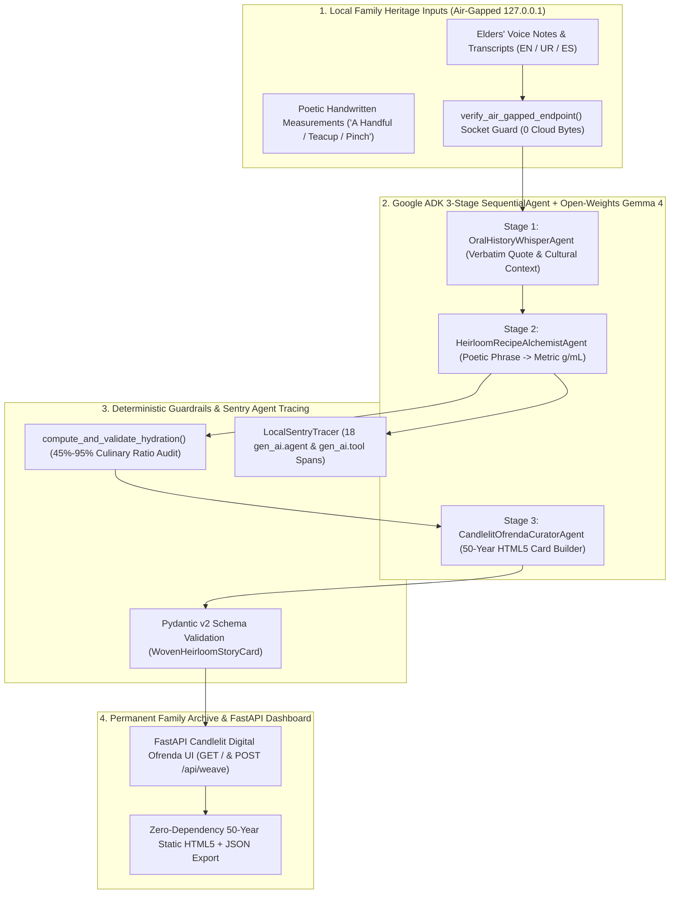

# 👻🕯️ MemoriaViva: Cute Ghost in the Machine: Open-Weights Gemma 4 & Google ADK Family Oral-History & Heirloom Recipe Weaver

[](https://dev.to/challenges/hacktoberfest-week4-2026-10-26)
[-4285F4?style=for-the-badge&logo=google&logoColor=white)](https://ai.google.dev/gemma)
[](https://google.github.io/adk-docs/)
[](https://sentry.io)
[](https://github.com/RobinaMirbahar/memoriaviva-gemma-ofrenda)


> **Author & Architect:** [Robina Mirbahar](https://github.com/RobinaMirbahar): Google Developer Expert (GDE) in Cloud & AI · Google Cloud Champion Innovator · Author of [*AI Engineering*](https://amazon.com/dp/B0GWCZWCF4)  
> **Challenge Track:** Hacktoberfest Open-Source AI Challenge Week 4: *Ghost in the Machine* (`#hf26challenge`, `#gemma`, `#googleai`)

---

## 🎯 Why I Built MemoriaViva

Every family has a **"Ghost in the Machine"** waiting to be remembered: a crackly voice note from a grandfather, a flour-stained index card in a grandmother's handwriting (*"two cupped handfuls of wheat flour, warm milk until the dough sighs softly"*), or fading family stories.

**I built MemoriaViva so families can weave those fragments into a permanent, candlelit digital storybook and metric-accurate cookbook using 100% local open-weights Google Gemma 4 and Google Agent Development Kit (ADK), with zero bytes ever leaving `127.0.0.1`.**


---

## 🏗️ System Architecture




---

## 🚀 Quickstart (One-Command Demo & Benchmark)

```bash
pip install -r requirements.txt
python scripts/run_memoriaviva_demo.py
```

### Launch the Interactive Candlelit Ofrenda Web App

```bash
uvicorn memoriaviva.dashboard:app --host 127.0.0.1 --port 8090
```


---

## 👩‍💻 About the Author

**Robina Mirbahar**: AI Researcher, Cloud Solutions Architect & Author of [*AI Engineering*](https://amazon.com/dp/B0GWCZWCF4)

[](https://github.com/RobinaMirbahar)
[](https://robinamirbahar.github.io/)
[](https://linkedin.com/in/robinamirbahar)
[](https://developers.google.com/profile/u/106918534005910641104)
[](https://dev.to/robinamirbahar)
[](https://medium.com/@robinamirbahar)
[](https://www.youtube.com/@robinacodesai)
[](https://amazon.com/dp/B0GWCZWCF4)
