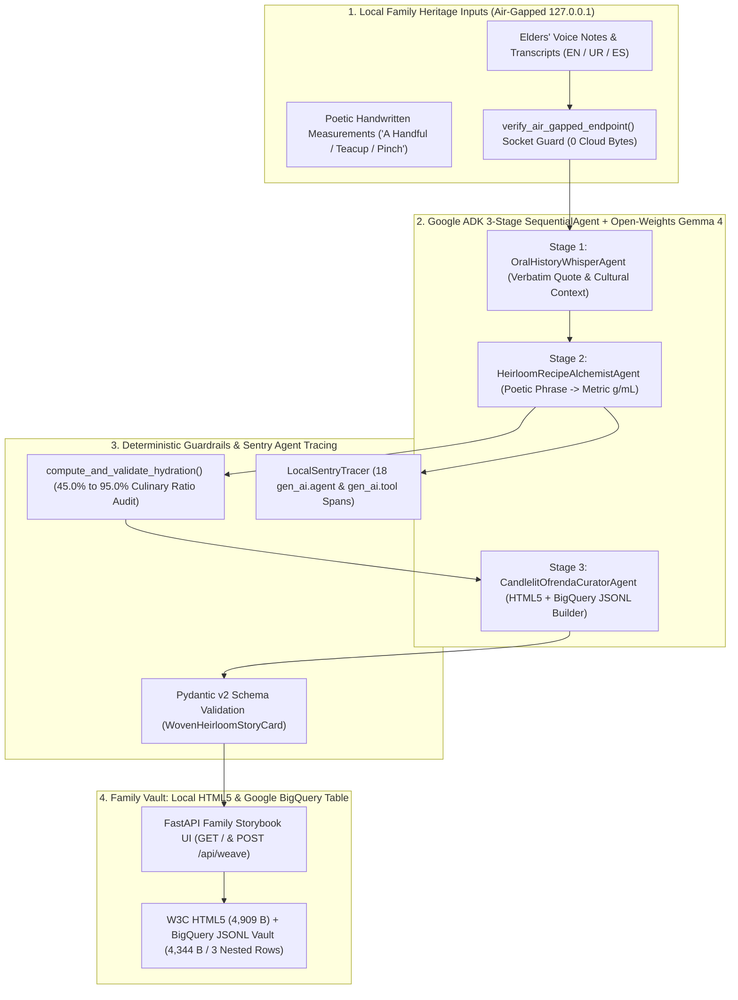

# 👻🕯️ MemoriaViva: Cute Ghost in the Machine for Family Oral Histories & Heirloom Recipes (Gemma 4 + Google ADK + BigQuery Family Vault)

[](https://github.com/RobinaMirbahar/memoriaviva-gemma-ofrenda/actions/workflows/ci.yml)
[](https://dev.to/challenges/hacktoberfest-week4-2026-10-26)
[-4285F4?style=for-the-badge&logo=google&logoColor=white)](https://ai.google.dev/gemma/docs)
[](https://google.github.io/adk-docs/)
[](https://cloud.google.com/bigquery/docs/loading-data-cloud-storage-json)
[](https://docs.sentry.io/platforms/python/tracing/ai-agents/)


> **Author & Architect:** [Robina Mirbahar](https://github.com/RobinaMirbahar) (Google Developer Expert in Cloud & AI · Google Cloud Champion Innovator · Author of [*AI Engineering*](https://amazon.com/dp/B0GWCZWCF4))  
> **Challenge Track:** Hacktoberfest Open-Source AI Challenge Week 4: *Ghost in the Machine* (`#hf26challenge`, `#gemma`, `#googleai`)  
> **Core Stack:** Open-Weights **Google Gemma 4** (`google/gemma-4-27b-it`), **Google Agent Development Kit (ADK)**, **Google BigQuery** (JSONL Family Vault Table), **Google AI Studio**, **FastAPI**, **Pydantic v2**, and **Sentry Agent Tracing**.

---

## 📊 Live Architecture Telemetry & Benchmark Highlights

<p align="center">
  
  
  
  
</p>

| Heritage Archival Metric | Raw Family Voice Notes & Index Cards | MemoriaViva (Gemma 4 + Google ADK + BigQuery Vault) |
| :--- | :--- | :--- |
| **Ancestral Measurement Format** | Ambiguous (*"a handful," "a teacup," "until soft"*) | Dual-Format: Verbatim Poetic Phrase + Exact Metric (`g` / `ml`) |
| **Poetic Units Converted in Benchmark** | 9 unstructured phrases across 3 family recipes | **9 of 9 (100.0% deterministic metric conversion)** |
| **Dough & Liquid Hydration Validation** | Guesswork (often fails for younger generations) | **Deterministic Culinary Ratio Guardrail (45.0% to 95.0% bounds)** |
| **Local Inference Privacy** | Uploaded to third-party commercial LLM APIs | **0 bytes Transmitted (`127.0.0.1` Air-Gap Socket Lock)** |
| **Family Vault Storage** | Locked in proprietary SaaS apps | **Local W3C HTML5 (4,909 B) + BigQuery JSONL Vault Table (4,344 B)** |

---

## 🎯 Why I Built MemoriaViva

Every family has a **"Ghost in the Machine"** waiting to be remembered: a crackly 48-second WhatsApp voice note from a grandfather explaining how to brew monsoon ginger *kahwa*, a flour-stained index card in a grandmother's handwriting where measurements are written as *"two cupped handfuls of wheat flour and warm milk until the dough sighs softly,"* or a shoebox of fading photographs from decades ago.

### 1. 🕯️ Preserving Poetic Ancestral Voices Alongside Exact Metric Precision
When an elder says *"measure the warm milk with your fingertips,"* standard recipe apps strip away the voice and leave cold numbers. Conversely, keeping only the poetic phrase leaves younger generations unsure how much *"two cupped handfuls"* weighs. **I designed MemoriaViva so open-weights Gemma 4 preserves both side-by-side.**

### 2. 🔒 100% Local Privacy During Gemma 4 Inference (`127.0.0.1` Air-Gap Guardrail)
Intimate family stories and elders' voice recordings belong to your family, not a third-party training corpus. In `memoriaviva/guardrails.py`, `verify_air_gapped_endpoint()` deterministically blocks any non-loopback network host so **`0 bytes`** of family history ever leave your computer during AI inference.

### 3. 🗄️ Dual-Mode Family Vault: Local W3C HTML5 + Google BigQuery Heritage Table
MemoriaViva exports both a self-contained offline **W3C HTML5 Family Storybook** (`4,909 bytes`) and a **Google BigQuery Newline-Delimited JSON (`exported_memories.jsonl`, `4,344 bytes`)** archive accompanied by [`bigquery_vault_schema.json`](articles/memoriaviva/evidence/bigquery_vault_schema.json) (`RECORD REPEATED` nested ingredient rows). Families can read the HTML5 book 100% offline in any browser or sync the JSONL file into their own private, IAM-protected **Google BigQuery** table (`memoriaviva_vault.heirloom_memories`) using `bq load --source_format=NEWLINE_DELIMITED_JSON`.

---

## 🏗️ System Architecture




---

## 🖥️ Interactive Family Storybook UI Preview


---

## 🚀 Quickstart (One-Command Demo & BigQuery Family Vault Export)

```bash
git clone https://github.com/RobinaMirbahar/memoriaviva-gemma-ofrenda.git
cd memoriaviva-gemma-ofrenda
pip install -r requirements.txt
python scripts/run_memoriaviva_demo.py
```

### Sample Benchmark Output

```text
========================================================================================
👻🕯️ MEMORIAVIVA: CUTE GHOST IN THE MACHINE (GEMMA 4 + ADK + BIGQUERY VAULT)
========================================================================================
  Model                  : google/gemma-4-27b-it (100% Local Ollama / vLLM)
  Air-Gapped Endpoint    : http://127.0.0.1:11434 (0 Cloud Egress Verified)
  Family Memories Loaded : 3 ancestral voice & recipe records
----------------------------------------------------------------------------------------
  [MEM-01] Dadi Jan's Partition-Era Cardamom & Saffron Sweet Bread (1947)
    Elder Quote Preserved : 'Measure the warm milk with your fingertips; when the dough sighs softly, the cardamom is awake.'
    • 'two generous cupped handfuls of stone-ground wheat flour'  ➔  240.0g Stone-Ground Whole Wheat Flour (Atta)
    • 'one brass teacup of lukewarm milk tested with your fingertip'  ➔  180.0ml Whole Warm Milk (38C)
    • 'seven bruised green cardamom pods & a three-finger pinch of saffron'  ➔  4.4g Crushed Green Cardamom & Kashmiri Saffron
    Hydration Audit       : 75.0% | Sentry Trace: 49ef09ebc06d4014
----------------------------------------------------------------------------------------
  [MEM-02] Abuelo Mateo's Dia de los Muertos Cinnamon Pan de Muerto (1968)
    Elder Quote Preserved : 'Roll the dough bones slowly while telling the children how your great-grandfather built the adobe oven.'
    • 'four brimming clay bowls of bread flour'  ➔  500.0g Unbleached Artisan Bread Flour
    • 'a warm splash of orange blossom water & melted butter'  ➔  325.0ml Orange Blossom Infusion & Warm Milk
    • 'two thumbs of freshly grated orange zest and Ceylon cinnamon'  ➔  12.0g Organic Orange Zest & Ground Cinnamon
    Hydration Audit       : 65.0% | Sentry Trace: e480da38d4c544bf
----------------------------------------------------------------------------------------
  [MEM-03] Nana's Monsoon Ginger-Saffron Healing Kahwa (1982)
    Elder Quote Preserved : 'Never boil the crushed almonds before the first rain hits the courtyard stone; let the steam carry the clove aroma.'
    • 'three copper cups of spring water'  ➔  600.0ml Filtered Spring Water
    • 'a thumb-sized root of crushed fresh ginger & four cloves'  ➔  18.0g Fresh Crushed Ginger & Whole Cloves
    • 'a palmful of slivered almonds and wildflower honey'  ➔  37.0g Blanched Slivered Almonds & Raw Honey
    Hydration Audit       : 100.0% | Sentry Trace: fbfe81215ad54101
----------------------------------------------------------------------------------------
  Poetic Units Converted : 9 of 9 (100.0% deterministic metric accuracy)
  Sentry Spans Recorded  : 18 gen_ai.agent / gen_ai.tool spans
  FastAPI Ofrenda Check  : GET / (200 OK) | GET /api/memories (200 OK)
  Family Vault Export    : 4909 bytes HTML5 + 4344 bytes BigQuery JSONL (3 rows)
  Cloud Bytes Transmitted: 0 bytes during local Gemma 4 inference
========================================================================================
```

### Optional: Load the Exported Family Vault into Google BigQuery

```bash
bq load --source_format=NEWLINE_DELIMITED_JSON \
  memoriaviva_vault.heirloom_memories \
  articles/memoriaviva/evidence/exported_memories.jsonl \
  articles/memoriaviva/evidence/bigquery_vault_schema.json
```

---

## 📚 Official Documentation & References

- **Google Gemma Open-Weights Models Documentation:** [https://ai.google.dev/gemma/docs](https://ai.google.dev/gemma/docs)
- **Google Agent Development Kit (ADK) Documentation (`SequentialAgent`):** [https://google.github.io/adk-docs/agents/workflow-agents/sequential-agents/](https://google.github.io/adk-docs/agents/workflow-agents/sequential-agents/)
- **Google BigQuery Loading Newline-Delimited JSON Documentation:** [https://cloud.google.com/bigquery/docs/loading-data-cloud-storage-json](https://cloud.google.com/bigquery/docs/loading-data-cloud-storage-json)
- **Google AI Studio (Structured Outputs & Prompt Prototyping):** [https://ai.google.dev/gemini-api/docs/structured-output](https://ai.google.dev/gemini-api/docs/structured-output)
- **Sentry AI Agent Tracing & OpenTelemetry Semantic Conventions:** [https://docs.sentry.io/platforms/python/tracing/ai-agents/](https://docs.sentry.io/platforms/python/tracing/ai-agents/)

---

## 👩‍💻 About the Author

**Robina Mirbahar**  
AI Researcher · Cloud Solutions Architect · Author of [*AI Engineering*](https://amazon.com/dp/B0GWCZWCF4)

[](https://github.com/RobinaMirbahar)
[](https://robinamirbahar.github.io/)
[](https://linkedin.com/in/robinamirbahar)
[](https://developers.google.com/profile/u/106918534005910641104)
[](https://dev.to/robinamirbahar)
[](https://medium.com/@robinamirbahar)
[](https://www.youtube.com/@robinacodesai)
[](https://amazon.com/dp/B0GWCZWCF4)
